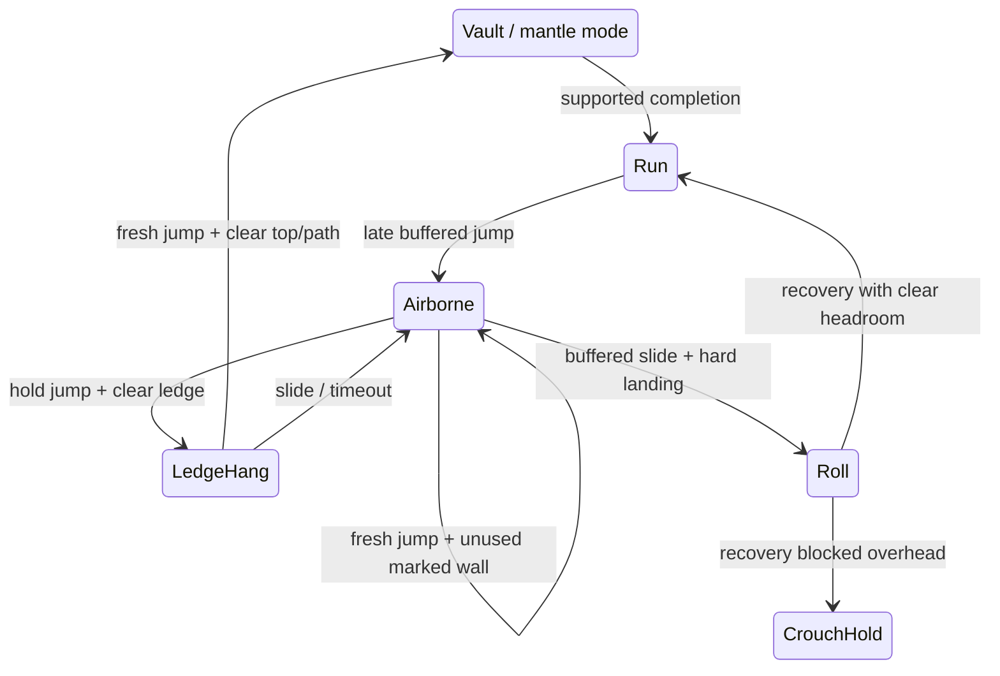

# Full-scene play, six courses and scene traversal

Current motion revision: **`motion-run-07-directed` / `lab-06-directed`**. See [scene choreography](scene-choreography.md) for pre-input binding, timely/late/missed outcomes, directed camera and shared preset editing. Current totals: **153 tests, 24 recordings, 30/30 lab events; 852 local poses / 19 ignored pages plus three generated sheets**. Earlier increment counts below are historical.

Implemented **25 October 2026**. The game has nine selectable entries: the original three training views plus six independently authored finite layouts. All six new courses have fixed semantic-input recordings that reach `Completed` with no failures using the production Simulation. These are automated rehearsals, not other-person usability trials.

## Scene-first interface

`play.html` fills the browser viewport with the game canvas. Only small floating panels remain: level/section/progress/time at top left; back/retry/pause/fullscreen at top right; a contextual action hint at the bottom; a collapsible Controls panel with keyboard hints and pointer buttons. `?` toggles Controls. Start/pause/failure/result cards temporarily overlay the scene. The optional native fullscreen button handles unsupported browsers without interrupting play. Safe-area insets and portrait layout keep controls on screen. There is no outer site header/footer, inspector, telemetry strip or scrolling gameplay document.

Renderer's `presentation: game` mode removes the lab grid, station headings and foot diagnostics; only nearby action marks remain. Walls/ledges carry distinct edge colors. Finite goals say FINISH. The original instrumented `lab.html` remains available for baseline debugging; new actions can be isolated through the new course checkpoints or Level Studio prefab tests.

## Added actions and controls

| Action | Deliberate input and scene requirement | Ownership / exit |
|---|---|---|
| Ledge catch | Hold Space/Up while airborne near a solid `ledge` or `wall-ledge` surface; grip height, front reach, body clearance and the capture corridor must be valid. | `LedgeHang` pins the body outside the corner. Space/Up starts mantle after a fresh press; S/Down drops. Timeout drops; re-grab delay prevents immediate reattachment. |
| Mantle | Fresh Space/Up from LedgeHang; top must fit the standing body, platform must be wide enough, and the normalized path must pass full segment sweeps. | A `mantle` mode of the existing Vault solver. Blocked tops keep the character hanging with rejection feedback. Completion returns to Run/CrouchHold. |
| Wall rebound | Fresh Space/Up while airborne within reach of a solid `wall`/`wall-ledge` surface. | Content-owned backward/upward impulse; one use per wall per airborne period, reset on landing/retry. It never adds another motion integrator. |
| Landing roll | Press S/Down shortly before a sufficiently hard landing. | Expiring input buffer commits Roll only on ground contact. Low body and timed recovery; blocked head clearance stays CrouchHold. A late jump can buffer across a clear roll exit. Pause clears uncommitted roll intent. |

All dimensions, timing, impulses, minimum impact and mantle knots belong to optional `rules.sceneTraversal`. Enabled new abilities require that object. Old 1.3 packages without the new abilities/object remain valid. Surface `traversal` adds `ledge`, `wall`, `wall-ledge`; the existing `auto` still classifies low vault/climb by size. Semantic bindings remain Space/Up, S/Down, E, hold Q, F, Escape and R. No new physical constants live in the UI.

## Six new finite layouts

| ID / title | Teaching route | Main actions |
|---|---|---|
| `roof-rhythm` / Rooftop rhythm | Gap, tunnel, narrow barrier, wide step | Jump, slide, vault, climb |
| `high-water` / High water | High ledge, supported top, two low steps | Catch, mantle, climb |
| `wall-signal` / Wall signal | Two marked walls separated by a vault | Wall rebound, vault, landing recovery |
| `soft-landing` / Soft landing | High roof drop, low tunnel, launch pad | Buffered roll, slide, pad |
| `cable-yard` / Cable yard | Raised approach, cable gap, pad gap | Climb, jump/cable, pad/roll |
| `crosscurrent` / Crosscurrent | Aerial chain, barrier, final ledge | Pad, swing, cable/dash option, vault, catch/mantle |

`parkour.json` owns these six `finiteLevels` and their instance geometry. `game-flow.json` owns their names/hints and section socket references. `resolveSocket` is shared by world compilation, editor and game-flow derivation; checkpoint positions/ranges are never copied into menu data. Content now contains **25 definitions, 18 visible library prefabs and 56 local entities**. Three new reusable prefabs are `unit-ledge`, `unit-wall-jump`, `unit-drop`; six terrain definitions are hidden from the prefab palette. All six layouts are editable using Level Studio's existing finite-level selector and production quick test.

## Presentation and verification

The existing local research pipeline supplies `wall_jump` samples 27–45, a fixed `wall_cling` pose 41 for hang, `corner_cling_low` 12–32 for mantle and `landing_roll` 34–54. The initially tried high-corner entry was revised because its hand placement did not match a hanging start. Mantle support uses bounded wrist alignment from entry; hang uses exact wrist anchoring. Roll uses lowest visible alpha support instead of ankle height so inverted poses do not sink below the floor. Scale still uses the same skeletal-chain calibration. Total: **702 local poses / 16 ignored pages**, plus three existing generated sheets. Publisher source code/art remains local-only; missing research pages use the procedural rig.

`test/fixtures/campaign-rehearsals.json` owns six recorded inputs and expected events, stamped with content/physics revisions. `npm run rehearse` now runs **21** recordings: 15 original lab cases (26/26 original events) and six complete finite routes. **130** Node tests cover the campaign, intent/clearance/timeout/hazard/re-grab rules, roll recovery, animation/contact and camera aspects. Ten current Edge browser scenarios include actual keyboard completion of High water, wall rebound/roll, all six loads, prefixed navigation, eighteen editor prefabs, and real pointer hang/mantle at 390 pixels.

Endless generation, final original animation/art, audio, shared scores, other-person trial and verified Pages release remain pending. No new dependency or public deployment is introduced. See [flow](game-flow.md), [3C](reference-driven-3c.md), [editor](level-editor.md) and [process](../../PROCESS.md).
