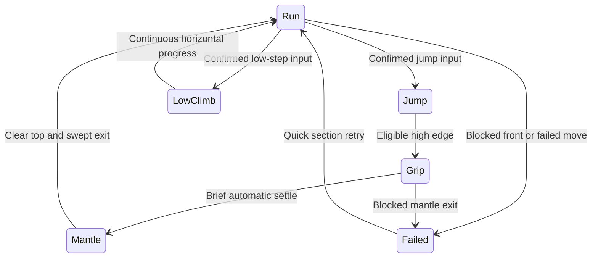

# Continuous play and recovery

Updated 1 November 2026 after a second round of player feedback.

| System | Current behavior | Canonical owner |
|---|---|---|
| Music | One looping source survives menus, level navigation, pause, completion and retries. Only an explicit music toggle stops it during normal application use. | `shell.js`, `audio.js`, `audio.json` |
| Track | Racing Game Title by MintoDog, 140 BPM, CC0; original audio is bundled unchanged. | `content/audio.json` |
| Failure | The game hides the failure overlay and retries the current section after 0.18 seconds. Manual pause and completion keep their menus. | `failureRetrySeconds`, `quick-retry.js` |
| Blocked approach | A grounded runner/slide/roll blocked in front for 0.28 seconds fails instead of repeatedly pushing against the wall. A short forward sweep includes collision-skin gaps. | `blockedRetrySeconds`, `simulation.js` |
| First-height climb | Low climb plays over 0.42 seconds with strictly forward horizontal progress and immediate run recovery. No separate hang or extra input. | `climbDurationSeconds`, `climbTrajectory` |
| Second-height climb | A committed jump arms edge capture for its flight. Catch → 0.10-second grip settle → swept mantle → run; no second press is needed. | `sceneTraversal.gripSettleSeconds`, `scene-traversal.js` |

The motion lab retains failure snapshots for diagnosis; automatic retry belongs to the player session. The simulator still reports failures and owns every collider movement. The retry controller uses presentation time, clears interpolation/held input on reset and does not reset the run's accumulated active-play timer. Hidden pages do not advance retry countdowns. A blocked high-edge exit fails safely instead of forcing a path through geometry. An explicit drop during the brief grip remains available.

`index.html` is a persistent same-origin screen host. `pages/home.html` contains the main menu; all player/editor screens remain independently authored. The host owns the audio engine, while screens mount controls onto that same engine. Navigation and browser Back/Forward replace the screen without destroying its music source. Public deep links such as `pages/play.html?level=high-water` enter the host automatically; canonical sharing uses `?screen=play&level=high-water`. A browser refresh or closed tab creates a new document and is not seamless application navigation. Browser autoplay rules still require the first gesture; muting is always respected.

Verification: 183 automated tests, 30 production recordings with 30/30 required lab events, and real browser checks for source identity across navigation/pause/retry, single keyboard/touch jump, blocked-slide recovery without UI, editor access, browser Back and explicit mute. Longer-route recordings were regenerated through the production simulator after the timing change. Subjective player confirmation remains pending.
