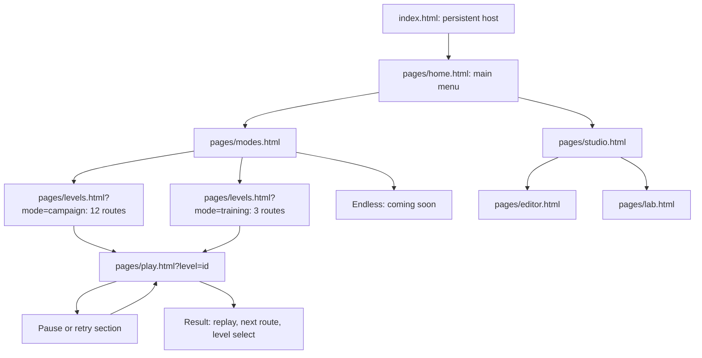

# Player flow

Latest movement/audio rules: [continuous play, automatic high-edge climb and quick retry](continuous-play.md).

Updated 1 November 2026. The root menu links to the page entries below. All routes are relative to the repository base URL.

`game-flow.json` owns mode membership, titles and section references. `game-flow.js` validates references, derives challenge views, chooses same-mode next/return links and stores best times. The six additional district courses reference existing module geometry. Endless remains disabled and explicitly labeled.

Gameplay fills the viewport. Small overlays show title, section, progress, elapsed time and current input hint. Controls provides four touch buttons; Sound provides music/effects toggles and volume. Escape pauses; focus loss clears held input and pauses. Retry starts the current section; Restart run returns to the route start. Music requires a first gesture, then continues through menus, pause, retries and results in the persistent host. Failed play retries the section in 0.18 seconds without showing its failure overlay. Storage failures keep the game playable and report unsaved results.
