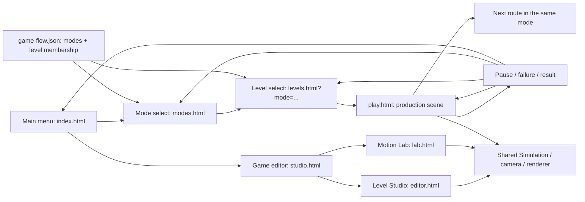

# Player menus and editor workspace

Implemented **25 October 2026**. Player navigation is **Main menu → Mode select → Level select → Game scene**. Authoring/testing lives under the separate **Game editor** entry. All URLs are static relative paths and work under `/polyu-ap-a3/`; no framework or build step was added.

| Screen | URL | Behavior |
|---|---|---|
| Main menu | `index.html` / root | Play, data-owned How to play dialog, fullscreen and a secondary Game editor link. Existing run art has a code-native silhouette fallback. |
| Mode select | `modes.html` | Campaign, Training and disabled Endless with a development notice. |
| Level select | `levels.html?mode=campaign` or `?mode=training` | Only that mode's routes, difficulty, local completion/best time and Start run. Back/Escape returns to modes. |
| Game scene | `play.html?level=<id>` | Viewport-filling production scene and small floating HUD/controls; ready/pause/failure/result menus. |
| Editor workspace | `studio.html` | Separate Level Studio and Motion Lab launchers; back to main menu. |
| Level Studio | `editor.html` | Existing full editor, terrain brush, prefab inspector, shared recipes and production quick tests. Brand returns to editor workspace; Motion Lab shortcut remains. |
| Motion Lab | `lab.html` | Existing nine-station loop, seventeen selectable rehearsals, tuning, detectors, telemetry and log. Brand returns to editor workspace; Level Studio shortcut remains. |

## Modes and route ownership

`content/game-flow.json` is the only owner of mode IDs, titles, descriptions, availability and each level's `modeId`. Modes contain no copied geometry or route ID arrays. Counts and completion totals are derived from references.

| Mode | Status | Routes |
|---|---|---|
| Campaign | Available | `roof-rhythm`, `high-water`, `wall-signal`, `soft-landing`, `cable-yard`, `crosscurrent` (six authored finite layouts). |
| Training | Available | `foundations`, `airways`, `momentum` (three views of existing lab stations, displayed as ordinary game scenes). |
| Endless | Coming soon / disabled | No playable entries; generation remains unimplemented. |

`game-flow.js` validates mode metadata, unique IDs, populated available modes, empty unavailable modes and valid level membership, in addition to existing station/socket checks. `gameModes`, `levelsForMode`, `modeForLevel`, `selectionUrl` and `nextLevel` centralize navigation. The renderer/UI cannot independently author mode membership. Legacy 1.0 catalogues without optional modes retain the previous single finite catalogue.

`menu.js` validates the shared catalogue and derives mode/route cards. No-query `levels.html` selects the first available mode (Campaign); unknown/unavailable mode URLs show a recovery message and Back. Direct bookmarked play URLs derive their return/next destinations from the level's canonical membership. `nextLevel` stops at each mode's final route, never crossing from training into campaign. Query parameters cannot reassign a route to another mode.

Authored routes still use `levelId` and ordered socket references; training views still use existing station IDs. `createChallenge` freezes the production package without writing new authored geometry, physics or timing into the menu. [Scene choreography](scene-choreography.md) and [campaign/action guards](campaign-and-scene-actions.md) remain unchanged.

## In-run menus and progress

Ready starts a run. Pause offers Resume, Restart run, Level select, Mode select and Main menu. Failure retries the current section; result offers replay and the next route within the current mode when present. The compact top-left back button returns to that mode's level select. Full run restart clears accumulated ticks and returns to the first section; section retry preserves cumulative active ticks. Pause/focus loss freezes and clears held/uncommitted input as before.

`motion-run.progress.v1` retains per-level best seconds in local storage. Both modes reuse those IDs; migration or account setup is unnecessary. Only the selected mode contributes to its completion counter. Corrupt or blocked storage does not prevent play. There is no shared leaderboard.

The controls dialog derives bindings from `parkour.json`, uses native modal focus trapping, explicit Escape/close handling and restores focus to its opener. Menu Escape returns one hierarchy level. Menus support keyboard and pointer; 390-pixel layouts stack cards without horizontal overflow. The player path contains no telemetry, tuning, export or editor links; those remain in the separate workspace. Original-derived PNGs remain ignored local material, and missing images do not block navigation.

## Verification and limits

153 Node tests and 24 deterministic recordings pass, retaining 30/30 required lab events and six complete finite routes. Four new mode tests cover membership, mode-bound next/back destinations, invalid authoring and legacy compatibility. Ten Edge scenarios cover main/help focus, mode gating, campaign pause/restart, actual foundations keyboard completion and 1/3 Training progress, bad URLs, direct links, both preserved editor tools, Pages-prefix links, 390-pixel layouts and missing-art fallback. No browser exceptions were observed. Automated checks are not an external usability trial. Endless generation, final original art/audio and verified public Pages publication remain pending.

Player hints use action names, press-now/late-chance prompts, move-ready confirmation and timing feedback. Fixed-clock/alignment/scene-matching diagnostics remain in Motion Lab; player key labels derive from the same bindings.
