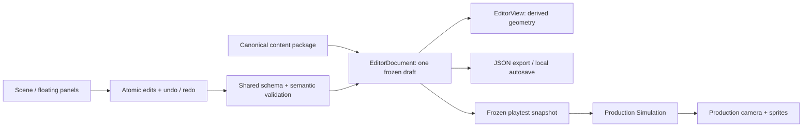

# Level Studio

Current motion revision: **`motion-run-07-directed` / `lab-06-directed`**. See [scene choreography](scene-choreography.md) for pre-input binding, timely/late/missed outcomes, directed camera and shared preset editing. Current totals: **153 tests, 24 recordings, 30/30 lab events; 852 local poses / 19 ignored pages plus three generated sheets**. Earlier increment counts below are historical.

Implemented **25 October 2026**. Open `http://127.0.0.1:4173/editor.html`, or choose **Level Studio** in the character lab. This static browser editor needs the same Node preview server as the game; no installation or backend is required.

## Scene and floating panels

The scene is the main workspace. Prefab library, Inspector, Level settings and Guide are independent floating panels: drag the title, resize the bottom-right corner, close them, or restore them from the bottom toolbar. **Panels** resets positions. The Inspector initially hides below 1000 px viewport width. Panel positions are presentation state and are not game content.

| Intent | Control |
|---|---|
| Pan | Middle/right mouse drag, or Alt-drag |
| Zoom | Wheel at cursor; + / − toolbar or keys |
| Select / draw blocks | V / B; drag a rectangle, with an H-scaled height reference |
| Place a module | Drag from the library; its entry follows the cursor. Inspector also accepts exact X/Y. |
| Select several | Shift-click, drag a box, or Ctrl/Cmd+A |
| Move selection | Drag; grid setting snaps the offset; arrows nudge, Shift increases nudge tenfold |
| Batch edit | Inspector X/Y offset, Duplicate, Delete; Ctrl/Cmd+D duplicates |
| Frame all / selection | Home / F |
| Undo / redo | Ctrl/Cmd+Z / Ctrl/Cmd+Shift+Z; toolbar buttons |
| Quick test | T / Quick test; selected-unit test in Inspector |
| Export | Export JSON or Ctrl/Cmd+S |

Selection and dragging use IDs. A pointer drag previews an offset and commits one transaction on release; cancellation commits nothing. Undo/redo retains up to 80 in-memory edit states. Rectangle width/height, anchor position, cable points, compatible profile and surface flags have typed geometry fields in prefab mode. Layout instances remain translation-only, without hidden scale overrides.

## Canonical movement prefabs

`content/parkour.json.modules` owns fifteen small library definitions and the shared course terrain. Individual actions and surfaces replace station-sized prefabs; the chained pad reuses one definition. All library entries use local [0,0] entry pivots. Geometry, detectors, profiles and rules have one owner. See [micro modules and terrain](micro-modules-and-terrain.md) for the palette, height rules and derived action space.

Drag a module from the library to the exact scene position; the ghost shows its entry and occupied rectangle. Free placement is the default. The + button places at the view centre, or appends after selection/finish when **Connect after selection / finish** is enabled. Unbranched route insertion reconnects and translates downstream units as one undoable transaction; branched/cyclic insertion is rejected. **Connect & align selected** is an explicit layout operation, not automatic reachability certification.

Double-click an instance or click a library name to edit its shared definition. Make unique first for an independent variant. Typed geometry includes positions, rectangle dimensions, cable points, surface/traversal flags and compatible profiles; advanced module JSON edits sockets, route descriptors and markers. Painting inside a shared module edits that same definition. Deleting geometry removes dependent authored markers; automatic block markers are derived.

The Block brush uses H=`climbMaxHeight` (1.2 m), with H, H/2, H/4 and Off; default H/4=0.3 m. Its character reference is 1.8 m=1.5H. Layout strokes create/reuse small block definitions. Narrow low obstacles can vault; broad low ledges can climb onto their top, subject to the shared simulation's clearance/support/trajectory checks. Too-high blocks remain solid. Module occupied bounds are derived; schema 1.3 has no authored `size` field.

## Level settings and persistence

Select an existing finite level in the top bar. Level settings chooses content revision and spawn/finish sockets; it can create a new named finite level starting with the last chosen prefab. Endpoint instances cannot be deleted until their spawn/finish reference is moved. Deleting other instances prunes their connections.

Every content edit, import and playtest uses the game's **1.3.0** structural schema and shared semantic validator. Invalid candidates leave the document/history intact. Separated sockets, incompatible posture/velocity envelopes, a declared graph without a spawn-to-finish path and a finish behind spawn are warnings. Free scene objects need no artificial socket-graph link. Passing validation is not a proof that a human or the runner can traverse the level.

Export downloads **one complete content package**, with all definitions, finite layouts, profiles, rules and existing endless descriptors. Import accepts JSON up to 8 MB and is undoable. Version 1.2 files/drafts remain pending until explicit conversion to 1.3; conversion preserves geometry, removes obsolete size boxes and uses canonical new-rule values. Unknown versions are rejected without replacing the draft. No imported scripts or arbitrary unknown fields are accepted. Export does not write into the repository or deploy the level: review the JSON before promoting it to runtime content, and requalify affected rehearsals/checkpoints.

Debounced autosave stores the draft and active level in browser localStorage. Reload offers **Recover** or **Keep current content** and holds further autosaves until a choice, preventing silent overwrite. Storage/quota failures show a message and leave JSON export available. Undo history, panel positions and playtest state are not persisted. Export remains the portable copy; browser storage is not a Git save.

## Quick test and SSOT

Full layout and selected-start tests freeze validated content and use the existing `Simulation`, `SemanticInput`, `FollowCamera` and `Renderer`. A placed prefab test retains its actual scene terrain and neighbors, with start/finish from its sockets. Unplaced modules get a clearly labeled temporary **PRACTICE FLOOR**, derived only for that frozen preview; jump previews retain a landing gap. It is not exported or treated as route qualification. Fall limits account for terrain elevation. Return destroys test input listeners and restores the untouched draft, camera and selection. The editor and header are inert during playtest. Space also matches painted low ledges to climb; it is not a full high-wall system.

## Verification and limits

102 Node tests pass. The original fifteen production rehearsals still cover 26/26 lab events and a full lap; low-ledge climb has separate integration/contact tests. Ten actual headless Edge CDP scenarios exercise native library drag/drop, placement ghosts and exact coordinates, H-scaled painting, real climb playtest, preview contexts, all fifteen module views, explicit legacy file conversion, storage recovery and compact layout, with zero exceptions. Export Blob/filename/content is tested before OS download, not OS download completion. Evidence: `.midwork/assignment3/lab-evidence/2026-10-25/micro-editor/`.

Endless generation, graphical route/witness tools, universal reachability qualification, production art, other-person trial remain pending. Read [micro-module behavior and limits](micro-modules-and-terrain.md), [editor contract](../Plans/Design/level-editor-requirements.md) and [TODO](../Plans/TODO.md).

## Explicit snapping, 25 October 2026

**Snap is on by default**, independently of H/H/2/H/4 spacing (default H/4 = 0.3 m). Disable it for free placement. A dragged group now snaps its first selected instance/entity anchor to absolute world coordinates while preserving all relative offsets; off-grid imported objects no longer remain permanently offset. Arrows share this rule. Palette drops snap the entry pivot; block strokes snap endpoints. Exact numeric transforms remain precision overrides. One drag is one validated undo step. Visible grid lines use the chosen spacing or a power-of-two multiple when zoomed out.

## Six-course and scene-prefab update

The finite selector now includes all six authored campaign layouts. The palette has eighteen prefabs, adding ledge, wall-jump and drop units. Surface traversal offers `none`, `auto`, `ledge`, `wall`, `wall-ledge`; hand contact/mantle/wall-jump rules use the production scene query. Socket references share `resolveSocket` with the game. Existing grid, batch edits, JSON validation, undo and immutable quick tests remain. See [campaign/actions](campaign-and-scene-actions.md).

Shared recipe workflow: select a prefab, open **Level settings → Shared scene performance**, choose its bound preset, edit JSON and Validate & apply. Sequence IDs must exist in the catalogue; preset IDs remain stable; camera base/variant keys must be ordered from 0 to 1. Edits are atomic, shared by all instances, exported with content and covered by undo. Quick test uses the same director.

Access the tools from the main menu **Game editor → Level Studio** (`studio.html` → `editor.html`). The studio brand returns to that workspace; Motion Lab remains a separate full diagnostics tool, with a shortcut in the desktop bar. Player mode/level screens contain no authoring panels.
