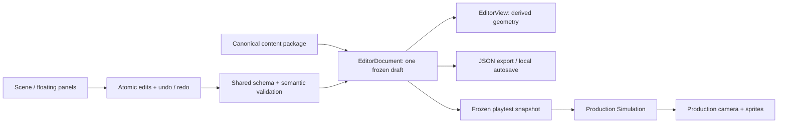

# Level Studio

Implemented **25 October 2026**. Open `http://127.0.0.1:4173/editor.html`, or choose **Level Studio** in the character lab. This static browser editor needs the same Node preview server as the game; no installation or backend is required.

## Scene and floating panels

The scene is the main workspace. Prefab library, Inspector, Level settings and Guide are independent floating panels: drag the title, resize the bottom-right corner, close them, or restore them from the bottom toolbar. **Panels** resets positions. The Inspector initially hides below 1000 px viewport width. Panel positions are presentation state and are not game content.

| Intent | Control |
|---|---|
| Pan | Middle/right mouse drag, or Alt-drag |
| Zoom | Wheel at cursor; + / − toolbar or keys |
| Select several | Shift-click, drag a box, or Ctrl/Cmd+A |
| Move selection | Drag; grid setting snaps the offset; arrows nudge, Shift increases nudge tenfold |
| Batch edit | Inspector X/Y offset, Duplicate, Delete; Ctrl/Cmd+D duplicates |
| Frame all / selection | Home / F |
| Undo / redo | Ctrl/Cmd+Z / Ctrl/Cmd+Shift+Z; toolbar buttons |
| Quick test | T / Quick test; selected-unit test in Inspector |
| Export | Export JSON or Ctrl/Cmd+S |

Selection and dragging use IDs. A pointer drag previews an offset and commits one transaction on release; cancellation commits nothing. Undo/redo retains up to 80 in-memory edit states. Rectangle width/height, anchor position, cable points, compatible profile and surface flags have typed geometry fields in prefab mode. Layout instances remain translation-only, without hidden scale overrides.

## Canonical movement prefabs

`content/parkour.json.modules` is the sole owner of geometry, sockets, routes and action markers. Nine definitions are `unit-jump`, `unit-slide`, `unit-vault`, `unit-dash`, `unit-swing`, `unit-cable`, `unit-pad`, `unit-chain` and `unit-recovery`. The lab's finite layout now references these definitions through nine instances; long floors/hazards were split at module boundaries without moving the course's obstacles or action planes. The current package contains **37 local entities** and **11 action markers**. No second editable prefab catalogue or baked collision map exists.

Click **+** to place a prefab after the selected instance, or after finish if nothing is selected. Entry/exit socket positions derive the translation and connection. Appending after the current finish advances finish. Inserting inside an unbranched connected route reconnects its next unit and translates the downstream chain as one undoable transaction; cyclic or branched insertion points are rejected. Turn off **Connect after selection / finish** for free placement at the view centre on ground level. **Connect & align selected** sorts selected units from left to right and aligns their sockets; this can move downstream units. Moving an instance otherwise does not silently repair its links: Level settings shows seam warnings.

Double-click an instance, or click its library name, to edit its **shared prefab**. All linked instances update. **Make selected prefab unique** creates a separate module variant and redirects the selected layout instance; in prefab mode it creates a new definition for subsequent placement. Add geometry with the entity menu. Duplicating an entity also duplicates its detector references; deleting an entity removes its dependent detectors in the same transaction.

Detector windows are drawn in prefab view. The advanced **Prefab data / detectors / sockets** JSON field edits the canonical module, including bounds, marker references/lead/late/height windows, socket contracts and route descriptors. Applying validates the entire package before replacing anything. The shared module ID cannot be renamed here. Editing geometry translates its derived marker plane; vertical eligibility windows remain explicit authored data and should be reviewed when changing obstacle height.

## Level settings and persistence

Select an existing finite level in the top bar. Level settings chooses content revision and spawn/finish sockets; it can create a new named finite level starting with the last chosen prefab. Endpoint instances cannot be deleted until their spawn/finish reference is moved. Deleting other instances prunes their connections.

Every content edit, import and playtest uses the game's **1.2.0** structural schema and shared semantic validator. Invalid candidates leave the document/history intact. Separated sockets, incompatible posture/velocity envelopes, unreachable connection-graph nodes and a finish behind spawn are warnings. Passing validation is not a proof that a human or the runner can traverse the level.

Export downloads **one complete content package**, with all definitions, finite layouts, profiles, rules and existing endless descriptors. Import accepts JSON up to 8 MB and is undoable. No imported scripts or arbitrary unknown fields are accepted. Export does not write into the repository or deploy the level: review the JSON before promoting it to runtime content, and requalify affected rehearsals/checkpoints.

Debounced autosave stores the draft and active level in browser localStorage. Reload offers **Recover** or **Keep current content** and holds further autosaves until a choice, preventing silent overwrite. Storage/quota failures show a message and leave JSON export available. Undo history, panel positions and playtest state are not persisted. Export remains the portable copy; browser storage is not a Git save.

## Quick test and SSOT

Full layout, selected-instance start and isolated-prefab tests freeze a validated content snapshot and run the existing `Simulation`, `SemanticInput`, `FollowCamera` and `Renderer`. An isolated prefab derives a temporary single-instance finite layout from its actual sockets; no second controller or movement defaults are introduced. Space/S/E/hold Q/F retain the game's controls; R retries and Escape pauses. Focus loss clears holds and pauses. **Return to editor** destroys input listeners and returns to the untouched draft, camera and selection.

## Verification and limits

**82 Node tests** pass. Fifteen deterministic production rehearsals still cover **26/26 events**, including a complete lap after the prefab split. Twelve headless Edge CDP scenarios exercised actual DOM/canvas/input: panel placement/hiding/dragging/resizing, zoom, marquee and batch dragging, batch inspector edits and undo/redo, all nine prefab views, invalid prefab rejection, isolated vault playtest/pause/return, prefab append, export Blob/filename/package, autosave recovery, and 820×720 layout. Browser exceptions: zero. Browser export content was captured before the OS download action; OS download behaviour is not part of this passed check. Evidence remains in workspace `.midwork/assignment3/lab-evidence/2026-10-24/editor/`.

Endless-preset editing/generation preview, graphical socket/route tools, witness authoring, full reachability qualification, persistent panel layouts and collaboration are future work. Rules/profiles are round-tripped but lack dedicated editor panels; the character lab provides its existing limited tuning form. Original sprites remain local research material; missing images use the visible rig fallback. The required other-person trial and public Pages release remain pending. See [editor contract](../Plans/Design/level-editor-requirements.md) and [TODO](../Plans/TODO.md).
