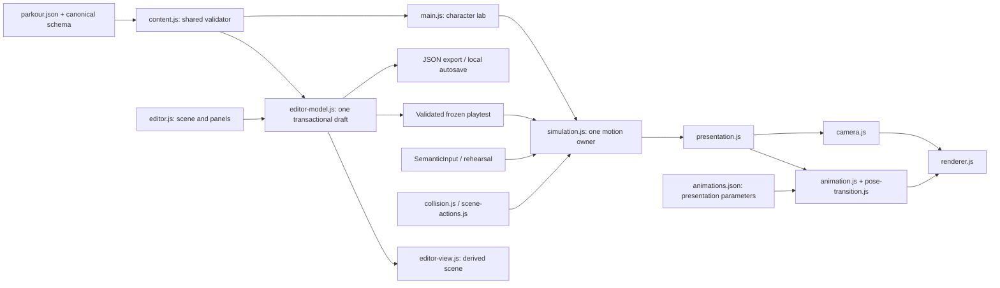

# Modules and relationships

Updated **25 October 2026**. The character lab and [Level Studio](level-editor.md) are implemented. Endless generation remains a design contract.

| Owner | Responsibility / consumers |
|---|---|
| `content/parkour.json` | Movement, camera, profiles; nine shared movement-prefab definitions and finite instance/socket layout. Game and editor read this one contract. |
| `content/lab-course.json` | Checkpoints, hints, coverage, fixed-frame rehearsals and scheduler bounds. Editor derives a temporary single-station adapter for quick tests. |
| `content.js` | Shared 1.2.0 structural validation, ID/profile/marker/socket-role/route/control checks and immutable world expansion. |
| `editor-model.js` | One frozen working document; validated atomic edits, bounded undo/redo, reference cleanup and frozen playtest compilation. |
| `editor-view.js` | Scene grid, geometry, sockets, markers, selection, pan/zoom; read-only derived presentation. |
| `editor.js` | Floating panels, scene gestures, inspector, level settings, local autosave, JSON I/O and shared-runtime playtest lifecycle. |
| `simulation.js`, `collision.js`, `scene-actions.js` | Sole 60 Hz motion/attachment owner, swept queries, geometry-derived detector windows, queued alignment and committed vault trajectory. |
| `input.js`, `rehearsal.js` | Semantic press/release/hold edges, captured target IDs, focus cleanup and fixed-tick scripted inputs. |
| `presentation.js`, `pose-transition.js` | Read-only fixed-tick interpolation, discrete pose timing, bounded visual pelvis/rotation inertia; no collider writes. |
| `assets/character/animations.json`, `animation.js` | Canonical crops/anchors/scale/sequence/presentation timing and snapshot-to-frame selection. |
| `camera.js`, `renderer.js` | Shared camera framing and Canvas scene/sprites/optional rig and detector overlays. |
| `main.js` | Character lab lifecycle, bounded scheduler, HUD, controls, tuning and rehearsal selection. |
| `test/`, `tools/` | Shared-content checks, production rehearsals, regression tests, local static server and research-art preparation. |

A Space edge captures the eligible marker. The simulator retains the request, aligns to a derived start plane and commits motion. Presentation selects the corresponding sprite and contact phase; interpolation and visual inertia cannot change physical contact or velocity. Hang/vault contact locks bypass root correction. Focus loss clears holds and pauses; retry resets pose memory through a new snap identity.

Editor edits clone one candidate, run the shared validator and replace the frozen draft only on success. Layout instances reference shared modules by ID. Quick tests derive a frozen snapshot and use the same production classes; stop removes input listeners without copying simulation state into the draft. Schema validity and socket warnings do not prove playability. See [current editor](level-editor.md) and [scene synchronization](scene-action-synchronization.md).

Original reference pages are hash-checked ignored local copies, not public release assets. Three generated sheets are versioned. There is no seeded generator, shared leaderboard or verified Pages publication.
