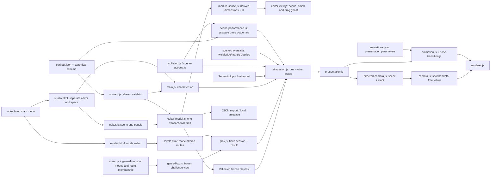

# Modules and relationships

Updated **25 October 2026**. The character lab and [Level Studio](level-editor.md) are implemented. Endless generation remains a design contract.

| Owner | Responsibility / consumers |
|---|---|
| `content/parkour.json` | Movement, camera, profiles and scene recipes; 25 definitions / 18 visible prefabs, shared terrain and finite instance/socket layout. Game and editor read this one contract. |
| `content/lab-course.json` | Checkpoints, hints, coverage, fixed-frame rehearsals and scheduler bounds. Editor derives a temporary single-station adapter for quick tests. |
| `content.js` | Shared 1.3.0 structural validation, ID/profile/marker/socket-role/route/control checks and immutable world expansion. |
| `module-space.js` | Derived action AABBs, height unit, block classification and entry pivot; no separate authored size. |
| `editor-model.js` | One frozen working document; validated atomic edits, bounded undo/redo, reference cleanup and frozen playtest compilation. |
| `editor-view.js` | Scene grid, geometry, sockets, markers, selection, pan/zoom, brush/drag ghosts; read-only derived presentation. |
| `editor.js` | Floating panels, scene gestures, inspector, level settings, local autosave, JSON I/O and shared-runtime playtest lifecycle. |
| `simulation.js`, `collision.js`, `scene-actions.js` | Sole 60 Hz motion/attachment owner, swept queries, geometry-derived detector windows, queued alignment and committed vault trajectory. |
| `scene-performance.js`, `directed-camera.js` | Prepare geometry/outcomes before input; select fixed clip clocks and sample root-independent scene shots. |
| `input.js`, `rehearsal.js` | Semantic press/release/hold edges, captured target IDs, focus cleanup and fixed-tick scripted inputs. |
| `presentation.js`, `pose-transition.js` | Read-only fixed-tick interpolation, discrete pose timing, bounded visual pelvis/rotation inertia; no collider writes. |
| `assets/character/animations.json`, `animation.js` | Canonical crops/anchors/scale/sequence/presentation timing and sequence clocks, landmark gait matching and snapshot-to-frame selection. |
| `camera.js`, `renderer.js` | Shared camera framing and Canvas scene/sprites/optional rig and detector overlays. |
| `main.js` | Character lab lifecycle, bounded scheduler, HUD, controls, tuning and rehearsal selection. |
| `test/`, `tools/` | Shared-content checks, production rehearsals, regression tests, local static server and research-art preparation. |

Geometry is pre-matched before a semantic input edge selects timely or late. The first signal pins the result and waits for its playback slot. Simulation commits the prepared path and clock; presentation selects the fixed outcome sequence and contact phase. A required unconfirmed scene plays its missed response. Directed camera sampling cannot read live player root/velocity. Focus loss cancels intent and pauses; retry resets shot/pose memory.

Editor edits clone one candidate, run the shared validator and replace the frozen draft only on success. Layout instances reference shared modules by ID. Quick tests derive a frozen snapshot and use the same production classes; stop removes input listeners without copying simulation state into the draft. Schema validity and socket warnings do not prove playability. See [current editor](level-editor.md) and [scene synchronization](scene-action-synchronization.md).

Original reference pages are hash-checked ignored local copies, not public release assets. Three generated sheets are versioned. There is no seeded generator, shared leaderboard or verified Pages publication.

[Small modules and terrain](micro-modules-and-terrain.md) document grounded low-ledge climb, auto markers, phase matching and context-preserving/practice-floor previews.

## Game-flow and 3C increment

`menu.js` reads `game-flow.json`; `game-flow.js` validates station references and derives immutable challenge packages. `play.js` owns scheduling, cumulative active ticks and finite result UI. `lab.html`/`main.js` preserve the original loop. `editor-snap.js` owns absolute batch-anchor snapping; camera and pose-transition retain presentation velocity. See [game-flow ownership diagram](game-flow.md) and [current 3C](reference-driven-3c.md). Geometry, physics and semantic input still each have one owner.

## Full-scene campaign ownership

- `scene-traversal.js`: pure wall/ledge acquisition and swept mantle planning; no body writes.
- `Simulation`: LedgeHang, mantle under Vault, one-wall airborne rebound, buffered Roll and recovery. One motion owner remains.
- `content.js / resolveSocket`: shared layout endpoint/checkpoint resolution for world, game flow and editor.
- `game-flow.json`: nine entries; six use authored level IDs and ordered section socket references. `parkour.json` owns six new layouts, 25 definitions/18 prefabs/56 local entities overall.
- `play.html / play.css / play.js`: full-viewport scene, compact floating HUD, contextual input feedback and collapsible keyboard/pointer controls.
- `campaign-rehearsals.json` in `test/fixtures/`, `runFiniteRehearsal` and `tools/rehearse.mjs`: six version-stamped complete production recordings, alongside eighteen lab cases (including three timing comparisons).

[Course/actions diagram](campaign-and-scene-actions.md) records the current transitions. Art/anchors remain owned by the animation catalogue; there is no separate UI physics or second map geometry.

## Scene director ownership, current revision

`scene-performance.js` binds geometry, timing variants, prepared paths, sequence phases and shot data before input. `directed-camera.js` samples immutable shot/time data; `camera.js` handles smooth handoffs and returns to free follow. `Simulation` advances selected variants and owns all physical results, including `SceneFailure`. `animation.js` consumes the same fixed clock; `presentation.js` preserves discrete recipe/shot boundaries. Editor exposes the same recipes and checks sequence references. See [current choreography](scene-choreography.md). There are now 18 lab rehearsals plus six complete campaigns.

The player menu stack now uses data-owned modes; six campaign and three training routes are separate. `game-flow.js` alone derives next/back URLs and prevents mode crossing. `studio.html` launches existing level and character tools independently. [Screen ownership](game-flow.md).
