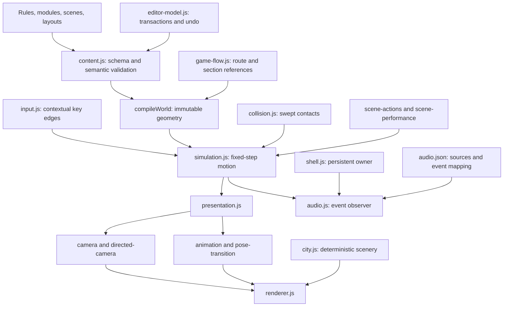

# Modules and ownership

Latest movement/audio rules: [continuous play, automatic high-edge climb and quick retry](continuous-play.md).

Updated 1 November 2026. The simulator is the only writer of character motion; canonical content owns gameplay facts.

| Owner | Responsibility |
|---|---|
| `content/parkour.json` | Movement tuning, shared modules, scene timing, 13 finite layouts including the lab |
| `game-flow.json` / `game-flow.js` | Twelve campaign routes, three training views, mode navigation and device-local records |
| `input.js` | Keyboard/touch aliases; Q chooses cable when eligible, otherwise swing; holds retain their press identity |
| `scene-traversal.js` / `simulation.js` | Swept ledge/mantle and other moves; traversal exit hands directly to running |
| `renderer.js` / `city.js` | Character contact alignment, foreground, idle/attached ropes and decorative city; no motion writes |
| `audio.js` / `audio.json` | Gesture unlock, bounded sound voices, looped music, preferences and missing-file tolerance |
| `editor-*` / `module-space.js` | Shared-content editing, derived footprints, snapping, terrain, undo and production playtest |

New district layouts reference existing modules with translated instances. They do not copy terrain entities into UI code. Audio and decorative palettes are presentation-only; neither affects recorded outcomes. [Structure](project-structure.md) · [Scene choreography](scene-choreography.md).

`screen-route.js` owns URL conversion; `screen-host.js` routes direct entries and intercepts same-app navigation. `quick-retry.js` resets failed player sections after the content-owned delay. Music lifetime is independent of simulation session state.
