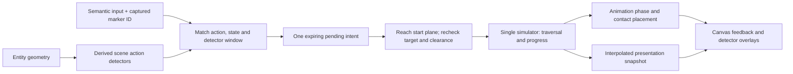

# Scene actions and animation synchronization

Implemented **24 October 2026**, content schema **1.2.0**, physics **lab-02**. This revision responds to the author's observed sprite jitter/size mismatch and request for early input followed by scene alignment. See [reference findings](../Plans/Research/vector-runtime-interaction.md) and [lab controls](character-lab.md).

## Interaction pipeline

A scene marker references an existing entity ID, an action/input pair, a start-edge offset, approach/late distances, a module-local foot-height interval and priority. `scene-actions.js` derives world bounds after instance expansion. Moving referenced geometry moves its start plane; the marker never copies the obstacle rectangle, anchor or cable path. Foot, forward-body and raised-hand probes use movement-owned body/grip dimensions. The grip is a reach probe while detached, not a literal hand joint in every pose.

Pressing Space in the vault approach queues a **vault**, continues running, and waits for the start plane. At alignment the simulator validates the referenced obstacle, supported exit and every swept trajectory segment. No input means no automatic vault. Space at the first gap and S at the tunnel use their corresponding markers; outside a matching scene context the normal jump/slide controls still apply. E/Q/F may queue inside their marked approach, but acquisition still requires the original physical range/cone/visibility or cable-capture check. Q must remain held.

The pending intent expires after the content-owned **0.5 seconds**, or cancels on leaving the allowed volume, an invalid locomotion state, released Q, pause, failure or retry. The marker ID is captured with the input and rechecked. Ground approach travel is clamped to the start plane, avoiding an overshoot/snap-back. High-speed crossings and collision-checked late alignment remain supported. Simultaneous requests resolve by marker priority; only one motion solver commits. Enable **Detectors** to inspect the fixed approach volumes and H/V/grip probes. The HUD shows queued/aligned status; the event log records `ActionQueued`, `ActionAligned` and `ActionCancelled`.

## Shared motion and contact

- Vault uses one normalized trajectory in `rules.vaultTrajectory`, a low collision body and `vaultDurationSeconds` for both swept motion and sprite progress. Clearance and support are checked before entry and along the path. The contact target derives from the obstacle's front/top, and a short, bounded visual correction locks the annotated hand to it. It never changes collision state.
- Slide has a short entry segment before the tunnel, a sustained low loop and an exit segment after legal standing clearance. The body remains low when the timer expires below a ceiling.
- Swing rope length/occlusion use the authoritative raised-hand `gripOffset`; cable capture/travel place that same grip on the cable. Camera lowest-point framing uses the same grip offset. Sprite hand annotations attach to this point; the renderer does not solve movement.
- Pads require eligible centre-foot/top contact at their geometry-derived contact mark, preventing a launch triggered only by the edge of the body.

## Jitter and scale corrections

The earlier run clock multiplied elapsed time by current speed, which could rewind its phase during acceleration changes. It now advances from accumulated travelled distance. `presentation.js` interpolates position, velocity, grip/cable distance and matching-state progress between fixed snapshots, without changing simulation results or crossing pause/reset boundaries.

Ten baseline presentation segments are prepared from nine source clips. Original skeletal samples are linearly interpolated from nominal 20 Hz to **60 Hz before rasterization**, producing **465 local reference poses on 11 atlas pages**. This is not image cross-fading or a claim to reproduce the reference's full pose-blending algorithm. Original source bytes and raster archives remain untouched. Sliding entry/exit use separate intervals from the same original clip.

Reference segments use a common actor-scale convention calibrated from a robust skeletal-chain measure; grounded Y anchors follow visible feet, while free airborne poses use a stable pelvis. Generated frames use explicit head-centre/pelvis estimates to normalize their upper-body scale. Hanging uses one calibrated pose per mechanic with continuous physical rotation/travel, avoiding the earlier 6-Hz switching between inconsistent generated silhouettes. Generated pad/release poses remain discrete key poses; full production in-betweens and rig retargeting remain pending.

`assets/character/animations.json` owns all runtime crop/scale/anchor/sequence metadata. The 11 reference pages remain ignored local research derivatives; the three generated pages are versioned. `npm run prepare:reference` copies hash-checked prepared pages. The local preparation/rebuild scripts and manifests are under workspace `.midwork/assignment3/tools/` and `reference-assets/vector-character-animation-runtime-v2/`; they are not another runtime controller.

## Verification and limits

**82 tests** pass, including queued/expired/cancelled input, identity/height guards, no automatic vault, high-speed start-plane crossing, read-only interpolation, 60-Hz frame metadata, grip-on-cable and the vault's full-weight hand-contact placement. **15 deterministic rehearsals cover 26/26 events**, including a full circuit and an early swing cancellation. Routes are checked for solid penetration. The schema, runtime package and fixture pass independent Draft 2020-12 validation.

Local offscreen captures of the real simulator/renderer/assets are under `.midwork/assignment3/lab-evidence/2026-10-24/scene-sync-v2/`. They are not browser screenshots or an external user trial. The original browser host still fails to initialize; twelve later headless Edge CDP editor scenarios pass. Human feel and target-browser compatibility still need a trial. The controller uses an approximate swept AABB, and generated landmark annotations remain estimates. The finite/prefab editor is implemented; endless generation, deployment and publisher-art redistribution remain outside this increment.

## 25 October: transition continuity

Interpolated presentation retains the previous discrete state and size until the new tick, and event-based animation cannot see a future event. Sequence changes use catalogue-owned `transitionSeconds: 0.10` and `transitionMaxOffsetMetres: 0.65` to ease body-relative pelvis and shortest-path rotation offsets. Pause freezes this memory; retry resets it. Hang, cable and vault contact locks bypass the correction. Nearest 60-Hz prepared poses render as one opaque silhouette; an experimental transparent crossfade was discarded after visible ghosting. This is bounded presentation inertia, not production skeletal blending or a second root-motion controller. See [Level Studio](level-editor.md).
