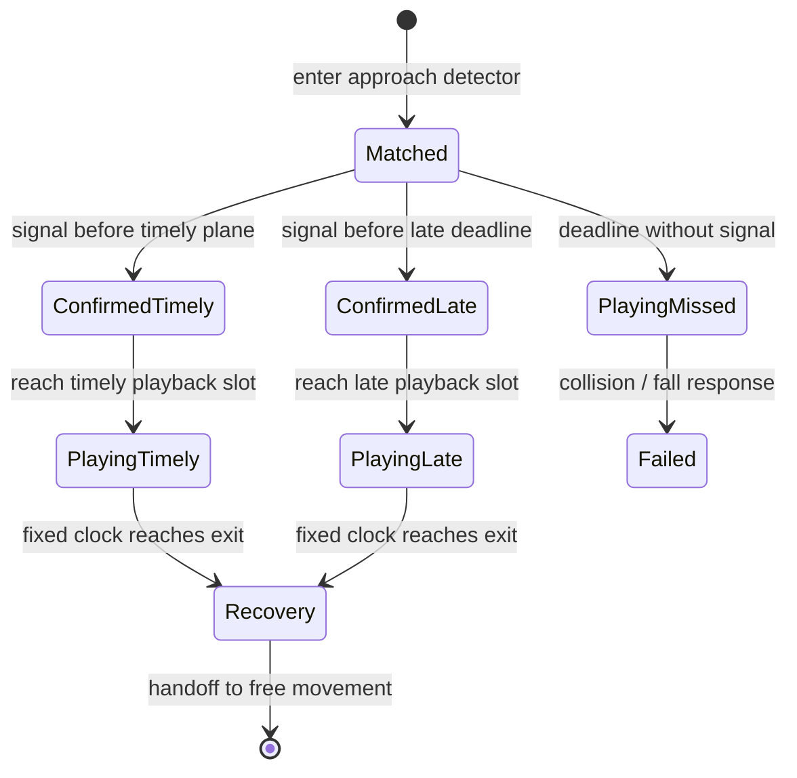

# Scene choreography and timing outcomes

Implemented **25 October 2026**, content `motion-run-07-directed`, physics `lab-06-directed`, catalogue `lab-sprites-05-directed`. This is the current scene-action contract; it supersedes earlier root-follow and expiring-input descriptions. Shared schema remains backward-compatible **1.3.0**.

## Order and ownership

`sceneActions` bind scene geometry to a shared `scenePerformances` recipe **before input**. `scene-performance.js` prepares the three entry transforms, traversal paths, exits, animation sequences and camera data. The player continues running while the recipe waits. One signal selects timely or late and pins that selection; repeated presses cannot downgrade it. Confirmation waits for its spatial playback slot instead of expiring with the generic jump buffer. Swing still requires its held signal at commitment. Pause cancels uncommitted intent; retry resets the match, clocks and shot.

`Simulation` alone owns movement. Vault/climb use the prepared, swept, normalized path and its duration. Jump uses a deterministic entry speed and impulse; slide uses the low-body owner until clearance. Grapples keep their existing single attachment solver. The recipe owns entry, pose clock and shot; it does not add an animation root-motion controller. Optional chained alternatives bypass when unchosen; ordinary required obstacles play a missed response. Jump pads remain automatic environmental impulses.

## One obstacle, three results

| Outcome | Input and playback | Vault example | Gameplay result |
|---|---|---|---|
| Timely | Confirm by `startX + timelyEndOffset`; enter timely slot | `vault` / `speed_vault` | Normal prepared vault and recovery |
| Late | Confirm after that plane but before `startX + lateDistance`; wait for the late slot | `vaultLate` / `pop_vault_start` | Later, 1.25-times-duration salvage vault |
| Missed | Reach the deadline without confirmation | `obstacleHit` / `wall_collision_from_run_and_jump` | Fixed collision/recoil, then failure; no automatic successful vault |

All seven marked kinds have timely/late/missed sequence references. Late jump lowers its impulse; a missed gap runs off and falls. Slide has a compact tumble entry; climb uses the mantle recovery clip; dash/swing/cable use distinct late entry poses and missed-grapple response. Generated hanging sheets still use selected stable poses rather than production skeletal blending. Secondary ledge hang/mantle, wall rebound and roll keep their own deliberate controls and receive directed shots; they are not three-outcome marker recipes. Release remains interactive for swing/cable. A held swing exits at its authored `playSeconds` limit (1.8 seconds in this package).

## Camera and presentation

A shot is sampled from prebound scene coordinates, normalized camera knots and simulation time. **During approach/playback/recovery, it does not read the live player root, instantaneous velocity or sprite pelvis.** Ground-action horizon remains stable; climb interpolates to the known landing height. Attachment framing uses the known anchor/cable envelope. Approach predicts travel once from captured initial speed/acceleration. Shot handoff retains camera position/velocity with a bounded cubic blend; release returns smoothly to free follow. The free-movement camera still uses its acceleration limits and visibility guards.

`sceneAnimation` selects the recipe sequence and normalized phase from the same fixed clock. `presentation.js` interpolates that clock, retaining the previous discrete recipe/shot until the next tick. Pose stitching is visual only; contact locks retain priority. Missed collision is a simulator state, not a camera shake. No clip can write collider position or velocity.

## Authoring and review

1. Select a placed unit or its library prefab in Level Studio. Open **Level settings → Shared scene performance**.
2. Select its bound preset. Edit anticipation, timely boundary, each variant's sequence/duration/input lock and camera knots/blend/release. IDs and world geometry remain shared references. Changes affect every linked unit.
3. Apply validates the whole candidate atomically, including clip existence, references and ordered camera keys. Undo restores the same document. Export uses the shared package; quick test uses the production simulator.
4. Open `lab.html`, station **Context vault**, and choose `timing vault timely`, `timing vault late`, or `timing vault missed` under Scripted rehearsal. All start at the same obstacle. Live input takes control from a rehearsal.

The seven recipe IDs are `scene-jump`, `scene-slide`, `scene-vault`, `scene-climb`, `scene-dash-grapple`, `scene-swing-grapple` and `scene-zipline`. `rules.performanceByKind` provides automatic painted-block defaults. Explicit marker `performanceId` overrides that mapping. `required: false` marks an optional branch. These are shared package fields, not separate editor defaults. Older 1.3 packages without recipes retain legacy behavior.

## Evidence and limits

153 Node tests and 24 deterministic recordings pass: 18 lab cases cover 30/30 required events, plus six completed campaign routes. New checks compare all three outcomes at one obstacle, confirm equal prepared paths for different early inputs, forbid late backward snapping, verify immutable snapshots and clock boundaries, and prove identical directed camera output despite injected root/velocity noise and across 30/60/120-Hz sampling. Browser checks cover three actual clips, editable shared presets, foundations completion and portrait play. These are automated checks, not another-person usability trials.

Reference-derived frames remain ignored local research assets with the clean-clone rig fallback. This implements an authored scene director inspired by the reference; it does not claim identical native Vector code or complete production animation quality. Endless generation, final original art/audio, external trials remain pending.
