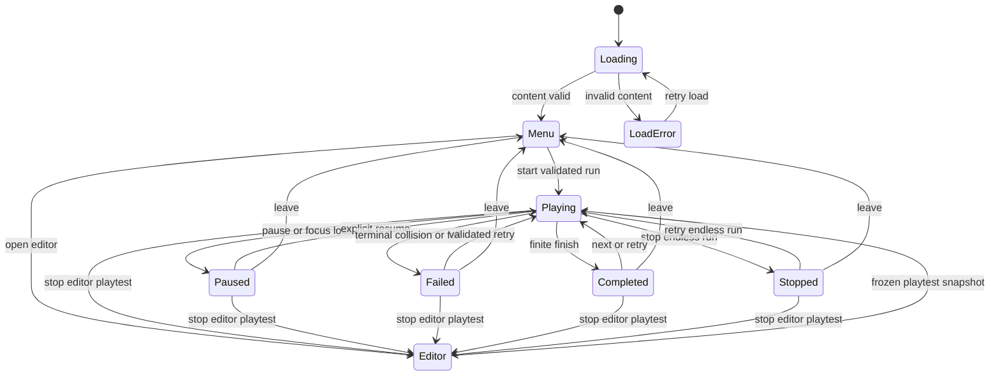
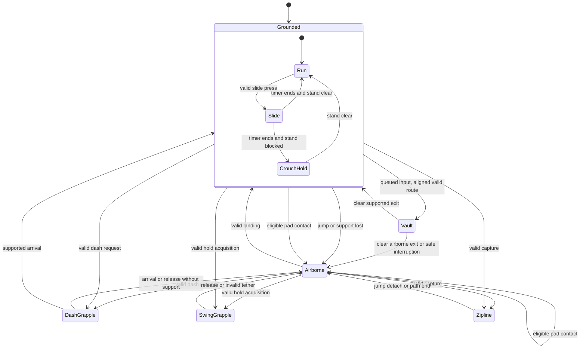

# Character and session state machines

Implementation correction, **25 October 2026**: marked units now prepare all three timing outcomes before input, confirm once, wait for outcome-specific playback slots and use a scene/time camera rather than root-driven following. Optional `scenePerformances`, marker `performanceId`/`required` and `rules.performanceByKind` extend shared 1.3.0 authoring. Runtime/editor use the same validated recipes; older packages retain legacy behavior. The authoritative implemented scope is [scene choreography](../../Current/scene-choreography.md).

**Implementation update, 24 October 2026:** baseline movement, four traversal additions, camera, semantic input, an authored circuit and prepared sprite mapping are implemented in the [character lab](../../Current/character-lab.md). See actual paths/owners in [modules](../../Current/modules.md). 66 tests pass; 15 rehearsals cover 26/26 events. This document retains the broader product contract; the editor, endless generation, streaming qualification and production animation blending remain pending.

Status: proposed implementation, not reverse-engineered Vector code. See [3C](three-c-design.md), [action/scene recipes](parkour-scene-implementation.md) and the [SSOT architecture](data-driven-architecture.md).

## State ownership

Use two coordinated layers: a session machine gates simulation; one hierarchical locomotion machine selects the player's motion owner. Animation, target highlighting and cooldowns are not parallel movement machines. Land/pad/attach/release are events or transitions, not persistent booleans.

### Session

Editor return transitions are guarded by playtest origin. Endless mode has no normal Completed transition; an explicit stop produces its own results reason. Generation/load errors are diagnostic outcomes, not scores counted as player skill failure. On retry, old state/pins are released atomically only after a fresh valid run is ready.

### Locomotion hierarchy

Airborne rise/apex/fall are derived phases of vertical velocity, not an independently mutable `isFalling` flag. Terminal outcomes are handled by the session machine from every locomotion state, even if not drawn repeatedly above. The figure is illustrative; the guarded transition table below is authoritative for omitted error paths.

## State context and exclusive motion owner

| State | Owned context and solver | Exit/cleanup |
|---|---|---|
| Grounded.Run | Support ID/contact; accelerate along allowed ground, swept body motion | Losing support enters Airborne; clear support reference. |
| Grounded.Slide | One timer; crouched body; ground sweep | On timeout test standing once per tick; blocked becomes CrouchHold. |
| Grounded.CrouchHold | Crouched body under obstruction; no slide timer restart | Stand only after clearance; support loss enters Airborne with a clearance-safe body. |
| Airborne | Velocity, last-supported tick and input-buffer references; gravity and swept motion | Landing resets appropriate grace/buffer state once. |
| Vault | Surface/route ID, start/end body positions, progress ticks; swept traversal path | Release claimed path; collision cannot be ignored by animation. |
| DashGrapple | Qualified anchor ID and travel context; swept pull solver | Stop at arrival/block; set configured exit velocity; clear pin/attachment. |
| SwingGrapple | Qualified anchor ID and rope length; constrained dynamics | Release with tangent velocity/cap; clear pin on all exits. |
| Zipline | Qualified cable ID, path arc length and direction; path solver | Exit with tangent and optional jump impulse; release cable pin. |

Runtime attachment is a discriminated union: none, dash anchor, swing anchor or cable. Do not retain separate independently writable `isGrappling`, `isSwinging`, `isZiplining` and target objects. Transitions exclusively own that union and motion-owner selection. Body posture derives from locomotion context, including one Airborne clearance constraint when needed; it is not an independent competing crouch flag. Pose/target UI derive from committed state, and a crouched ledge fall does not add a second solver.

## Guarded transitions

| Current context | Request/event | Guard | Result and side effects |
|---|---|---|---|
| Run/Airborne | Jump | Grounded or coyote eligibility; buffered edge not consumed | Set jump velocity once, consume request, clear support, Airborne. |
| Run | Slide | Grounded, ability enabled, crouch body fits | Enter Slide and change body once. |
| Slide/CrouchHold | Stand | Full standing volume clear | Run; preserve legal foot position. |
| Run | Vault | Enabled, tagged surface, height/width/range limits, entire sweep and exit clear | Claim path; enter Vault; otherwise reject. |
| Run/Airborne | Dash press | Target ID matches preview and all profile/visibility/cooldown checks pass | Pin anchor, consume request/cooldown once, enter DashGrapple. |
| Run/Airborne | Swing press/hold edge | Compatible visible target; reach, initial rope length and cooldown valid | Pin target, establish rope without teleport, enter SwingGrapple. |
| Swing | Release, blocked tether or invalid target | Existing attachment | Preserve legal release velocity, unpin, Airborne. |
| Run/Airborne | Zipline press | Within capture region, path and state compatible | Pin cable and initialise arc length once. |
| Zipline | Jump/F detach/end | Existing cable | Tangent exit; optional jump impulse only for jump; unpin, Airborne. |
| Grounded/Airborne | Pad contact | Eligible top-face foot sweep, rearmed trigger | Apply one replace/add policy after collision resolution; Airborne next tick. |
| Any locomotion | Lethal contact/fall | Terminal condition | Session Failed once; release all attachments and reject movement commands. |
| Any locomotion | Finite finish | Valid finish and no higher-priority lethal event | Session Completed once; freeze outcome and clear command buffer. |
| Any locomotion | Focus loss/pause | Session Playing | Freeze world, clear input; explicit resume resolves stale holds before motion. |

In the first design, new grapple/zipline acquisition is rejected during Vault, Slide/CrouchHold or another attached mode; detach first, then issue a fresh action. Buffered jump does not become an unexpected jump immediately after a grapple release. These rules can later change through one transition policy with regression tests, not per-level exceptions.

## Fixed-tick update and priority

1. Process session pause/retry/stop first. A paused session does not advance simulation ticks or gameplay timers.
2. Collect bounded semantic input; discard repeats, expire jump buffer and resolve current attachment release/cancel before new acquisition. Fresh contextual jump-off beats a conflicting cable toggle.
3. Select at most one requested transition: valid swing acquisition, dash acquisition, cable capture, grounded/coyote jump, slide, context vault; stable explicit order resolves simultaneous presses. Invalid higher-priority requests do not consume lower valid intent unless a state change has committed.
4. Integrate exactly one active solver and perform its swept collision/constraint checks. Keep pre-impact velocity for feedback; never drive the body again from animation root motion.
5. Resolve contact events in order: lethal collision/fall, valid finite finish, eligible pad launch, ordinary landing/support changes. Pad impulse sets next-tick velocity without a second integration. Trigger IDs prevent double fire.
6. Commit state once, update owned timers once, then publish an immutable render/event snapshot. UI/camera/animation consume it without writing simulation values.

Input acquisition priority is an explicit deterministic policy, not a claim that one mechanic is intrinsically better. Physical contacts can interrupt a requested move, and terminal events override every action. Same-tick finish plus lethal contact resolves to failure; no double reward or second result screen.

## Boundary and regression cases

- Jump exactly at coyote/buffer boundaries; held keys must not retrigger impulses or spend cooldown twice.
- End a slide below a ceiling, leave a ledge crouched, and stand only with legal clearance.
- Hit geometry mid-dash/vault, lose an anchor, release a swing at an apex, or reach a cable endpoint.
- Hit a pad and a lethal volume on the same tick; only the terminal result wins.
- Pause while holding swing; release/focus change while paused; resume without phantom acquisition.
- Retry/fail/stop editor playtest while attached; no target/module pin leaks.
- Stream a module boundary during an attachment; pin until cleanup. An unexpected unresolved reference fails safely and diagnostically.

The lab implements the baseline locomotion/session subset in `src/simulation.js` and snapshot-driven sprites in `src/animation.js`; the complete menu/editor/results graph remains proposed. Streaming reference cleanup is not implemented or qualified.

## Scene synchronization revision, 24 October 2026

The shared contract is now 1.2.0, adding scene markers, context-input lifetime, grip offset and normalized vault trajectory. The previous 1.1.0 pair is archived locally. Space queues a vault in a matching approach and executes after start-plane validation, superseding the earlier automatic-vault assumption; normal jumping remains outside a matching context. Actual owners, reference evidence, smoothed assets and checks are in [current scene synchronization](../../Current/scene-action-synchronization.md).

## 25 October implementation note

The [small-module revision](../../Current/micro-modules-and-terrain.md) implements grounded low-ledge climb as a mode of the single Vault owner, relative-height/clearance checks, end-of-action queued intent, captured-target stability, real traversal velocity, stable camera focus/prediction and phase-matched run recovery. Schema 1.3 also derives block detectors and intended occupied space from shared data. This adds no full high-wall/wall-run system or seeded generator.

Finite sessions add `Completed`: finish clears intent and freezes motion. [Current game flow](../../Current/game-flow.md) specifies results/retry; the lab still resets at its lap gate.

Current extension: full-scene floating HUD, six independently authored finite layouts, LedgeHang/mantle, wall rebound and buffered landing Roll are implemented. Shared optional sceneTraversal data, surface modes, socket-referenced checkpoints and qualified recordings are specified in [current campaign/actions](../../Current/campaign-and-scene-actions.md). Endless generation and final original animation remain pending.
