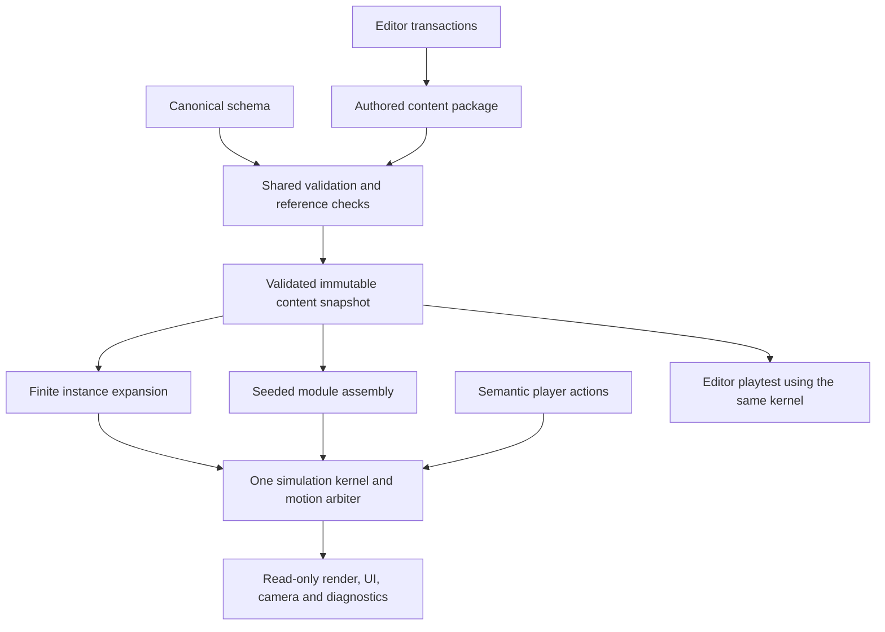

# Data-driven architecture and SSOT

Implementation correction, **25 October 2026**: marked units now prepare all three timing outcomes before input, confirm once, wait for outcome-specific playback slots and use a scene/time camera rather than root-driven following. Optional `scenePerformances`, marker `performanceId`/`required` and `rules.performanceByKind` extend shared 1.3.0 authoring. Runtime/editor use the same validated recipes; older packages retain legacy behavior. The authoritative implemented scope is [scene choreography](../../Current/scene-choreography.md).

**Implementation update, 25 October 2026:** the lab, finite/prefab editor, small-module terrain brush, automatic low-ledge climb and shared 1.3.0 data contract are implemented. 102 tests pass; the original 15 rehearsals cover 26/26 lab events. See [actual owners](../../Current/modules.md) and [micro-module behavior](../../Current/micro-modules-and-terrain.md). Endless generation, universal composition qualification and production skeletal blending remain planned.

Status: broader design contract; shared content, lab simulation and finite/prefab editor implemented; endless generation pending. Product authority: [requirements](../Requirements/game-requirements.md). Structural contract: [content-package.schema.json](Schemas/content-package.schema.json). Examples are fixtures, not another source of defaults.

## Rules

SSOT means each fact has one authority, not that all data must be one global mutable object. Separate immutable authored content, one session's mutable simulation state, editor state and derived presentation. Runtime and editor must use the same content model, validation and simulation library.

Code owns reusable algorithms and typed mechanic handlers; data owns their parameters, content and selection rules. Adding a genuinely new mechanic can require a new handler and schema revision. Data-driven design does not mean executing arbitrary code from JSON.

| Fact | Single authoritative owner | Allowed derived consumers | Forbidden duplication |
|---|---|---|---|
| Movement, collision dimensions, traversal profiles | Versioned content package `rules` and typed `profiles` | Simulator, target preview, reachability checks, trajectory preview | Editor-only gravity, hidden per-level speed constants or copied HUD cooldowns. |
| Module geometry, local entities and sockets | `modules` definitions keyed by stable ID | Runtime instances, collision shapes, renderer, editor | Separate handwritten collision map and art coordinates for the same gameplay surface. |
| Finite layout | `finiteLevels` instance list and endpoints | Runtime expansion and editor viewport | Baked entity copies edited independently of source modules. |
| Endless selection/limits | `endlessPresets` | Seeded generator and diagnostics | Generator defaults duplicated in UI or ad hoc difficulty switches. |
| Current player/body/attachment/cooldowns | Session simulation state | HUD, camera and renderer read snapshots | Position in render objects becoming authoritative physics. |
| Seed, PRNG state, sequence and active instances | Session generation state | Streaming and debugging | Renderer/asset loader consuming the gameplay random stream. |
| Editable document | One editor working document plus transactional history | Inspector, hierarchy and viewport selection by ID | Inspector object copies or a second mutable preview document. |
| Running editor playtest | Frozen content snapshot and isolated session state | Shared production runtime | Playtest mutating the draft or using different physics. |
| Saved record | Versioned local save store | Results and menus | Local save overriding authored movement or level definitions. |

## Data flow

The arrows describe the full proposed product. The lab and finite/prefab editor implement shared loading, validation, transactional authoring, frozen same-simulator playtest and presentation; actual paths are in Current/modules. The editor working document becomes a saved content package on export. Do not allow arbitrary scripts in imported content.

## Contract ownership and versioning

The schema file is the sole machine-readable **structural** authority for the proposed package; derive language types/inspector field descriptions from it or validate against it, rather than maintaining parallel handwritten schemas. Semantic constraints such as cross-reference validity, ranges with ordered endpoints and playable paths belong to one shared semantic validator described in [level design](level-data-and-generation.md). Do not claim JSON Schema alone proves those properties.

`schemaVersion` controls file migration; `contentRevision` identifies authored content; `physicsVersion` identifies movement behaviour; `generatorVersion` identifies selection/PRNG behaviour. The run signature includes those values and a seed. A replay also records fixed-tick actions. Same-signature sequence determinism is required; cross-browser bit-exact physics is not promised without explicit testing.

Use stable string IDs, module-local coordinates in metres, +X forward, +Y up, radians for angles, seconds for time and metres/second for speed. The viewport converts to screen coordinates. Initial module placement supports translation only; rotation, scale and mirroring are unsupported until their contracts are explicitly designed.

Numeric defaults live in package data and are never copied from prose examples. Missing required data fails validation; do not silently invent a second default. Derived expanded geometry, indexes, previews and compiled artefacts are rebuildable, read-only caches tagged by content hash.

## Runtime boundaries

1. Loading parses to a candidate, validates shape/references/semantics, resolves IDs and freezes a snapshot atomically.
2. Fixed mode expands authored instances. Endless mode appends compatible instances using the preset and owned PRNG state. Both feed the same entity instantiation and simulator.
3. Input mapping produces semantic actions. A single locomotion arbiter applies at most one motion owner per tick. Trigger events request transitions instead of writing velocity independently.
4. One simulation state owns position, velocity, attachments and cooldowns. Render/UI read snapshots. Pause/focus loss freezes simulation and clears latched input; resuming requires fresh intent.
5. Persistent personal scores use separate versioned records. Optional network submission consumes finished run results and cannot become required for play.

## SSOT acceptance

- Edit one profile once: play, preview arcs, target ranges and inspector views all observe it after validation.
- Edit a module surface once: collision and gameplay drawing move together in finite and endless instances.
- Reuse a module twice without copying its entity definitions; IDs are qualified per instance at runtime.
- Editor export/import produces the same canonical content, ignoring only defined metadata/order normalisation.
- Undo is a transaction on the one editor document; playtest stop restores no duplicate state because the draft was never mutated.
- Rebuild caches after data changes, and fail on dangling IDs/unknown schema versions rather than falling back to hidden values.

The example remains a specification fixture. The lab uses native JavaScript/Canvas, the shared schema and separately authored runtime content; it does not read the fixture as defaults.

## 3C contract revision

Proposed schema **1.1.0** extends the one `rules` owner with camera, acceleration, body-query tolerances, bounded input and vault tuning, and completes swing acquisition cone data. Its example revision is an untested design fixture. The previous 1.0.0 schema/example are archived locally outside the repository; no production importer/migration has been implemented. A later importer must migrate explicitly or reject old versions rather than add silent second defaults.

Runtime state shape/guards belong to the [state-machine specification](character-state-machine.md); [3C](three-c-design.md) and [scene recipes](parkour-scene-implementation.md) reference the same fields. Camera and animation may own presentation state, but never player position or gameplay RNG. Source image metadata remains a research catalogue. Runtime mapping has one separate owner, `assets/character/animations.json`, derived from that provenance and consumed by presentation only.

## Scene synchronization revision, 24 October 2026

The previous 1.2.0 contract added scene markers, context-input lifetime, grip offset and normalized vault trajectory. The previous 1.1.0 pair is archived locally. Space queues a vault in a matching approach and executes after start-plane validation, superseding the earlier automatic-vault assumption; normal jumping remains outside a matching context. Actual owners, reference evidence, smoothed assets and checks are in [current scene synchronization](../../Current/scene-action-synchronization.md).

## Schema 1.3: small-module composition

Authored `module.size` is removed. Shared `module-space.js` derives intended motion/transition AABBs from geometry, detectors and canonical rules/profiles. Surface `traversal: auto` derives painted-block vault/climb markers at compile time; it is not duplicated editable detector data. H comes from `rules.climbMaxHeight`. Atomic definitions use entry [0,0], while terrain has one geometry owner. Layouts may be free compositions without socket links; declared links still validate roles and report seams. Old 1.2 files require explicit undoable conversion.

The disabled endless preset now references starter ground; isolated action attachments are not qualified generator modules. Future endless patterns must compose terrain plus actions, prove entry/exit compatibility and rehearse through the shared simulator before activation. Intended editor envelopes do not certify every possible input, release or neighbor composition.
