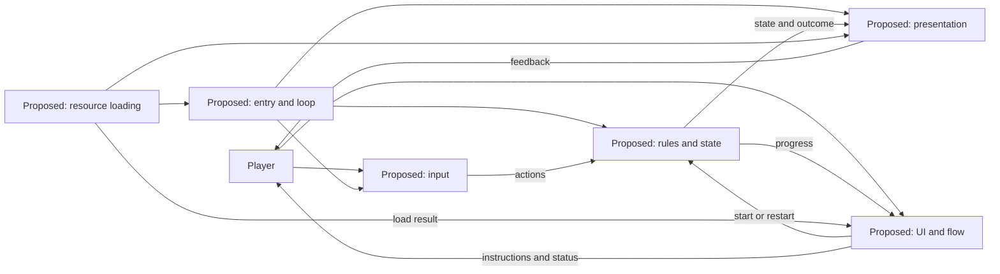

# Parkour game and GitHub Pages plan

Date: **22 October 2026**. This is a plan, not an implementation report. See [TODO](TODO.md) and the [assignment brief](Requirements/assignment3-brief.md).

## Confirmed direction

- Develop a small game in `polyu-ap-a3`, playable directly from a GitHub Pages link.
- Focus on one complete input/response/feedback loop, understandable controls and a manageable scope.
- Maintain root README, PROCESS and STANDARD, with Current, History and Plans documentation.
- Keep repository project documentation in English, with a Chinese counterpart at workspace `.midwork/assignment3/polyu-ap-a3/` using the same relative paths.
- Keep current structure, modules and glossary aligned with every code/configuration change.
- Use Vector as a reference for an original parkour game; add dash grapple, swing grapple, zipline and jump-pad environment interactions.
- Deliver authored finite levels, rule-based endless assembly of preset modules and a level editor, with strict data-driven SSOT.

Requirements authority: [game requirements](Requirements/game-requirements.md). Design: [SSOT](Design/data-driven-architecture.md), [data/generation](Design/level-data-and-generation.md), [editor](Design/level-editor-requirements.md). Evidence: [Vector analysis](Research/vector-reference-analysis.md). A shared schema, illustrative fixture and playable character lab now exist. Full game modes/editor and release remain pending; see [current lab](../Current/character-lab.md).

## Decisions still needed

| Topic | Required decision |
|---|---|
| Player and setting | Intended player, target device and suitable session length. |
| Movement details and goal | Tune the required traversal, action chaining, results and retry. Proposed baseline is side-view auto-running, not yet a confirmed control choice. |
| Controls and feedback | Inputs and visible/audible changes a first-time player understands. |
| Technology | Native JavaScript/Canvas lab implemented; static root served with Node, no bundling/dependencies required. |
| Assets | Necessary visuals/sound and shareable sources. |
| Error or interruption | At least one realistic failure or interruption to handle. |
| Shared ranking | Whether to include a leaderboard, and whether GitHub login and delayed submission are acceptable. See the [research](Research/github-only-leaderboard.md). |

## Candidate game modules

The table and diagram describe the broader product. The lab now uses native JavaScript/Canvas with actual source boundaries recorded in Current/modules; editor/generation responsibilities remain planned.

| Responsibility | Purpose |
|---|---|
| Entry and loop | Initialise and coordinate game updates. |
| Input | Convert the chosen device inputs into game actions. |
| Rules and state | Own the game state and apply rules/actions. |
| Presentation | Render state and provide feedback; sound only if useful. |
| UI and flow | Explain, start, show results and restart where applicable. |
| Resource loading | Supply assets and handle the selected loading failure if relevant. |
| Static build and release | Produce and publish browser files, outside the runtime loop. |
| Shared content and validation | Own schema, profiles, module references and semantic checks for play/editor. |
| Finite/endless level providers | Expand fixed instances or assemble validated modules into the same runtime. |
| Editor | Edit modules, fixed layouts and endless presets; playtest frozen snapshots through the same simulator. |

Record actual paths and relationships in [Current/modules](../Current/modules.md) after implementation. Shared scores are not part of this committed core scope.

## Pages delivery

Choose a static browser output compatible with [GitHub Pages hosting](https://docs.github.com/en/pages/getting-started-with-github-pages/what-is-github-pages). Expected URL: `https://spathering.github.io/polyu-ap-a3/`; not verified live.

1. Build a minimum playable local version and document exact installation, preview and production commands.
2. Verify resource resolution and refresh under `/polyu-ap-a3/`.
3. Identify the actual static output directory; publish only the files needed to play.
4. Configure Pages and an appropriate build/deployment workflow, checking current versions and permissions against the [official workflow guide](https://docs.github.com/en/pages/getting-started-with-github-pages/using-custom-workflows-with-github-pages).
5. Test production output and the actual URL, then publish verified controls, screenshot, link and limitations in README.

## Optional leaderboard

Research supports a possible GitHub-only, asynchronous score board using authenticated Issue submissions and optional Actions aggregation. It does not establish anonymous in-game writes or trusted scores. Decide after the core mechanic is clear; gameplay must remain available without score submission. No account integration, data file or workflow has been added. See [full research](Research/github-only-leaderboard.md).

## Acceptance and milestones

- A visitor can open the verified Pages link and play without installing an app or using a paid account.
- Input changes state with clear feedback and understandable next steps; relevant restart/stop and selected error handling work.
- Assets and refresh work under the project base path; target browsers have no blocking errors.
- At least one other person tries it before explanation; an improvement or reasoned decision is recorded in PROCESS.
- README includes real run instructions, a screenshot, a verified live link and limitations; PROCESS, credits and development history are complete.
- Optional shared scores have explicit identity, submission, latency and trust limits before implementation.
- All four requested traversal mechanics, finite and endless play and the editor pass their linked acceptance scenarios; no requirement is silently reduced to a stretch goal.
- Data owners, schema, semantic checks and production/editor simulation remain shared and authoritative.

Suggested sequence: choose the stack and refine the movement proposal; build shared contracts/validation and a movement slice; add four traversal test modules; complete fixed layout authoring/editor; validate endless assembly; playtest, deploy and finish submission documents. Deadline: **1 November 2026, 23:59 Hong Kong time**.
