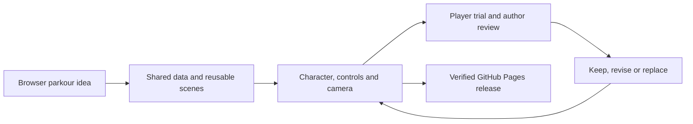

# Development process

## Initial idea

I wanted to make a small parkour game that opens directly in a browser through GitHub Pages. Vector was the main reference for readable movement, obstacle timing and the feeling of continuous running. The intended player can learn a few inputs quickly, read the next obstacle and improve through short retries.

I chose two modes for the long-term design: fixed, authored routes and an endless mode assembled from predefined modules. The current game implements twelve campaign routes and three training routes. Endless assembly and shared online scores remain plans, not completed features.

## Design and implementation decisions

I required a data-driven architecture with a single source of truth (SSOT). Movement rules, scene recipes, module geometry and level composition belong to canonical JSON; the game, editor and tests consume the same data. I also asked for a level editor with floating panels, prefab placement, terrain drawing, grid snapping, batch editing and quick testing.

| Design choice | Reason and result |
|---|---|
| JavaScript and Canvas with no build step | A checkout and the hosted game run the same source with no paid service or backend dependency. |
| Character, controls and camera designed together | Input, motion, animation contacts and camera movement must describe one understandable action. |
| Match the scene before accepting an action | A confirmed input waits for an authored playback window. Timely, late and missed inputs have different outcomes for the same obstacle. |
| Directed action cameras | Following the animated root too closely produced shaking; camera paths now cooperate with the traversal instead. |
| Reusable modules and smaller terrain units | Authored geometry can be combined into longer routes and edited precisely without copying obstacle definitions. |
| Separate player menus and editor workspace | Players enter through home, mode and route selection; development panels remain in a separate workspace. |
| Presentation separated from simulation | Sprite anchors, pose transitions, scenery and audio never move colliders or decide the physical outcome. |
| Persistent music owner | Replacing an embedded screen keeps the same audio engine alive through navigation, pause and retry. |

## Changes guided by my review

I directed the scope and evaluated the results rather than accepting each implementation unchanged. I asked to replace the early animation presentation with prepared frames, then requested corrections for changing sprite size, jitter and poor contact with obstacles. I also corrected the interaction model: the scene should match first, input should confirm the action, and playback should begin when the runner reaches the designed window.

I retained reusable scene modules, the looped motion lab, shared data and the editor's quick-test workflow. I required smaller placeable units, terrain drawing and default grid snapping when the original larger units limited composition. I changed the player-facing interface into conventional game menus and kept the old tools behind a separate editor entrance.

For climbing, I rejected the need for another input after a successful high-edge catch. A high climb now briefly settles at the grip and continues automatically; a low step keeps moving and returns directly to running. I also requested quick section retries instead of a failure popup. The permission review of character art is another release decision: earlier access to source frames and attribution do not establish redistribution permission, so unverified reference-derived art must be replaced in the public release.

## User testing and feedback

I collected and relayed feedback from people who tried the game. Codex did not observe those sessions directly, and this document does not invent participant identities, measurements or quotations.

| Reported feedback or observed problem | Change made in response |
|---|---|
| Standing up after a high climb seemed to pause for one or two seconds | Removed extra landing recovery, connected the high grip to automatic mantle, and kept low climbs moving continuously. |
| Too few combinations and a sparse city | Added six composed districts, bringing the campaign to twelve routes; added layered buildings, windows, rooftop details, cranes, clouds and city palettes. |
| Swing points were distant and the intended rope action was hard to see | Lowered anchors and drew ropes before attachment. |
| Separate swing and cable keys were inconvenient | Combined both on Q and one touch control, resolving the action from the nearby scene. |
| Missing audio, music restarting between screens, and insufficient sense of speed | Added credited effects, selected a 140 BPM track and moved music to a persistent host. |
| Failed moves interrupted play; sliding into a high block could leave the player stuck | Added blocked-front detection and automatic retry of the current section without a failure menu. |

The screenshot of the blocked runner was used to reproduce the wall-stall case. Keyboard and touch checks cover one-input high climbing, and browser checks confirm music-source continuity through menus, pause and retries. Automated verification currently includes 183 tests and 30 recorded scenarios. These checks establish reproducibility and catch regressions; they do not replace player judgment about rhythm, difficulty, animation quality or the sound mix. A further player review remains open.

I selected the openly licensed CC0 Agent pixel character after reviewing the style tradeoff. The reference-derived atlases and earlier generated traversal sheets are removed from the current release, and the new source is credited in both entry documents.

## AI use and responsibility

I used Codex to investigate the reference, organize requirements, propose implementation options, write and revise code, prepare level data, diagnose bugs, research asset licenses, run checks and maintain the English documents and local Chinese counterparts. Image generation was used for experimental traversal poses. AI-produced code and artwork still required integration, calibration and review.

My decisions defined the game, deployment target, SSOT requirement, scene-input model, editor workflow, menu organization and the changes requested after playtesting. Codex handled implementation details such as collision sweeps, interpolation, source ownership and regression checks. I accepted features that supported the intended flow and requested revisions when the camera shook, sprites did not match geometry, climbing stalled, controls were fragmented or failure UI interrupted play. The development record distinguishes my requests from implementation choices made by Codex; it does not present every AI suggestion as a decision I personally made.

## Reference & Thanks

| Resource / contributor | Use and credit |
|---|---|
| [Vector — Nekki](https://vector.game/zh-Hans/) | Parkour design reference; extracted artwork is not part of the current release. |
| [Agent SMS — Chasersgaming](https://opengameart.org/content/adventure-series-character-agent-sms) | CC0 pixel character; selected source frames and project-authored action mappings. |
| [Racing Game Title — MintoDog](https://opengameart.org/content/racing-game-title) | CC0 background music, 140 BPM. |
| [Interface Sounds — Kenney](https://kenney.nl/assets/interface-sounds) | Seven CC0 sound effects. |
| OpenAI Codex / image generation | Code, research, checks and documentation assistance; earlier generated art experiments are retired. |
| Playtesters | Feedback on movement, controls, content, city scenery and audio. |

[Character sources and adaptations](Documents/Current/animation-assets.md) · [Audio sources](assets/audio/README.md) · [Permission review](Documents/Plans/Research/character-asset-license-review.md).
