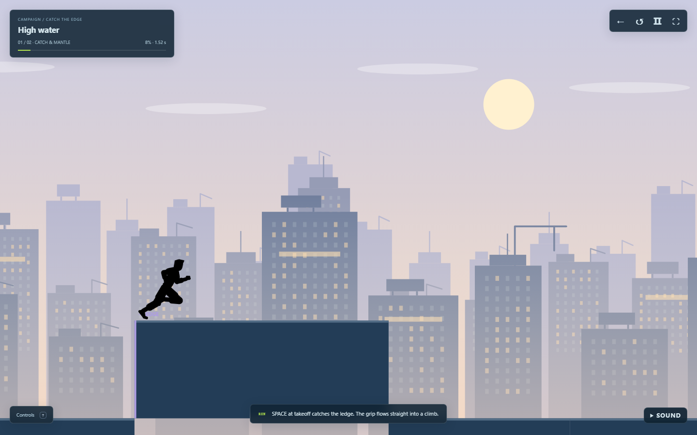
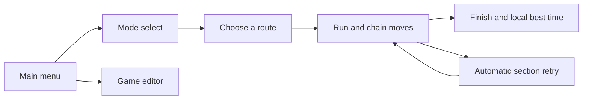
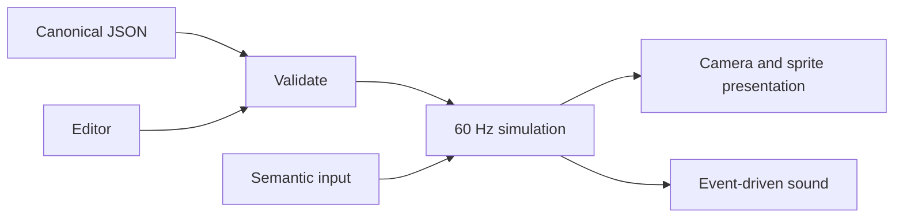

# Motion / Run

**Read the city. Commit to the move. Keep your momentum.** A side-view browser parkour game with twelve campaign routes, three training routes and a separate level editor.

[Play now](https://spathering.github.io/polyu-ap-a3/) · [Level Studio](https://spathering.github.io/polyu-ap-a3/pages/editor.html) · [Development process](PROCESS.md)





| Control | Action |
|---|---|
| Space / ↑ | Jump, vault or climb; catch and automatically climb a high ledge |
| S / ↓ | Slide; buffer a landing roll; drop from a ledge |
| E | Dash grapple |
| Q | Hold to swing, release to let go; near a cable, press to attach or detach |
| Esc / R | Pause / retry current section |

Forward running is automatic. Press in the marked approach; the move starts at alignment. Late and missed inputs have different outcomes. Touch controls are under **Controls**. **Sound** provides music/effects toggles and volume; playback starts after a gesture and continues across menus, pause and retries. Failed moves quickly restart the section without a popup. Best times and sound preferences stay in this browser.

## Run and develop

Node.js **20+**, a modern browser, no third-party packages and no build step.

```sh
npm run dev       # http://127.0.0.1:4173/
npm run check    # content, atlas and audio integrity
npm test         # simulation, input, presentation and editor
npm run rehearse # recorded production routes
```

```text
index.html       Persistent screen and music host
pages/           Player screens, Level Studio, Motion Lab
styles/          Page styles
content/         Canonical rules, modules, routes, schema and audio catalogue
src/             Shared simulation, editor, rendering and audio
assets/          Bundled character art and audio
test/           Regression tests and recorded routes
tools/          Local server, validation and rehearsal commands
Documents/       Current guides, history and plans
```



The project targets readable, continuous parkour and reproducible static hosting. Scene recipes bind input windows, fixed animation and directed cameras to shared geometry. Editor tests use the production simulator; rendering never moves collision bodies. New district routes reference existing modules. See [architecture](Documents/Current/modules.md), [current features](Documents/Current/continuous-play.md) and [plans](Documents/Plans/TODO.md). Endless generation and shared online scores remain planned.

**References & thanks:** [Vector / Nekki](https://vector.game/zh-Hans/) informed movement and supplies the credited reference-derived character atlases; three traversal sheets were generated with imagegen. [Racing Game Title — MintoDog, 140 BPM](https://opengameart.org/content/racing-game-title) and [Kenney Interface Sounds](https://kenney.nl/assets/interface-sounds) supply the bundled CC0 audio. [Asset details](Documents/Current/animation-assets.md) · [Audio sources](assets/audio/README.md). Codex assisted with implementation, research and verification; decisions and player feedback are recorded in [PROCESS](PROCESS.md).
